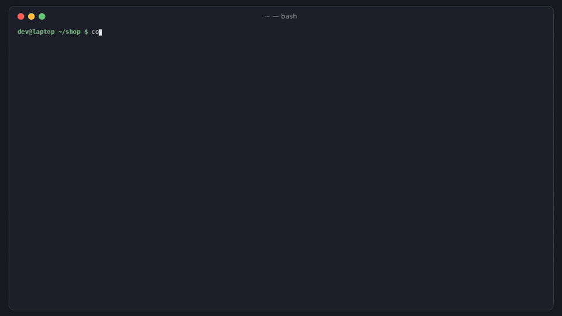

# confroll

[](https://github.com/hamarshehmhmd/confroll/actions/workflows/ci.yml)
[](LICENSE)


**You edited a ConfigMap. Half your pods are still running the old value.** Kubernetes doesn't restart pods when a ConfigMap or Secret changes. Values read through `env`/`envFrom` and files mounted with `subPath` stay frozen until something replaces the pod ([kubernetes#22368](https://github.com/kubernetes/kubernetes/issues/22368), open since 2016). `confroll` finds those workloads before you merge, tells you what a config diff will actually roll out, stamps config hashes so edits trigger a rollout, and lists the running pods that are already behind.



```sh
curl -fsSL https://raw.githubusercontent.com/hamarshehmhmd/confroll/main/install.sh | sh
```

## What it does

| Command | Input | Answers |
|---|---|---|
| `confroll scan` | manifests (files, dirs, `-`) | Which workloads will **not** see an edit to the config they read? Which config-triggered rollouts could take every pod down? |
| `confroll plan` | two manifest sets, or `--git-base origin/main` | For this PR, which workloads roll, which stay **STALE**, which only get live-refreshed files, which break because a referenced config was deleted? |
| `confroll stamp` | manifests → stdout | Adds `confroll.dev/config-hash` to each pod template (hash of the ConfigMaps/Secrets it reads) so a config edit changes the template and triggers a normal rolling update. |
| `confroll stale` | `kubectl get pods,cm,secrets -o yaml --show-managed-fields` | Which running pods started **before** the ConfigMap/Secret they read at startup was last written? Prints the `rollout restart` to fix it. |

It understands the ways teams already solve this and doesn't flag them: [Stakater Reloader](https://github.com/stakater/Reloader) annotations (`auto`, typed `auto`, reload lists, `search`/`match`), [Wave](https://github.com/wave-k8s/wave), Helm-style `checksum/*` template annotations, kustomize generator hash suffixes, and `immutable: true` configs. References are read from `env.valueFrom`, `envFrom`, `configMap`/`secret` volumes and `projected` sources, across init and regular containers, per namespace.

Secret values are never printed; `plan` shows changed key names only.

## Install

```sh
curl -fsSL https://raw.githubusercontent.com/hamarshehmhmd/confroll/main/install.sh | sh
```

The installer uses `uv tool`, then `pipx`, then a private venv in `~/.local/share/confroll` (needs Python 3.9+ and git). Or:

```sh
pipx install git+https://github.com/hamarshehmhmd/confroll
```

The only dependency is PyYAML. No cluster access is needed except for `stale`, which reads what you pipe in.

## Usage

### Scan manifests

```console
$ confroll scan examples/shop
5 workloads, 3 ConfigMaps/Secrets scanned
ERROR   CR001 Deployment/api  examples/shop/workloads.yaml
        reads ConfigMap/shop-config via envFrom (api); editing it leaves running pods on the old values until something restarts them. ...
ERROR   CR001 Deployment/edge  examples/shop/workloads.yaml
        reads ConfigMap/shop-config via subPath nginx.conf (nginx, never refreshed); ...
INFO    CR002 Deployment/web  examples/shop/workloads.yaml
        mounts ConfigMap/web-assets as a volume (volume (web)); kubelet refreshes the files within about a minute, but nothing restarts the pods
WARNING CR004 Deployment/payments  examples/shop/workloads.yaml
        a config edit rolls this workload, but strategy Recreate stops every old pod before a new one starts
3 error(s), 2 warning(s), 1 info
```

Works on rendered output too: `helm template . | confroll scan -`, `kubectl kustomize overlays/prod | confroll scan -`. Raw Helm templates with `{{ }}` aren't YAML, so they are skipped with a warning. Render them first.

Formats: `--format text|json|sarif|github`. Exit code is 1 when a finding reaches `--fail-on` (default `error`; `warning`, `info`, `none`).

| Rule | Severity | Meaning |
|---|---|---|
| CR001 | error | Config read via `env`/`envFrom`/`subPath` and nothing triggers a rollout when it changes |
| CR002 | info | Config only mounted as a volume: files refresh (~1 min), but only helps if the app re-reads them |
| CR003 | warning | StatefulSet/DaemonSet `updateStrategy: OnDelete`: a rollout trigger changes the template but replaces no pods |
| CR004 | warning | A config edit rolls this workload, but there's no readinessProbe, `Recreate` strategy, or `maxUnavailable` covers every replica |
| CR005 | error | `confroll.dev/config-hash` doesn't match the current config; re-run `stamp` |
| CR006 | info | Referenced config isn't in the scanned manifests (created elsewhere), so it can't be hashed |
| CR007 | warning | Bare Pod reading config: nothing ever restarts it |

### Plan a config change (PRs)

```console
$ confroll plan --git-base origin/main k8s/
ConfigMap/shop-config (modified keys: FEATURE_NEW_CHECKOUT, nginx.conf)
  STALE            Deployment/api
                   reads it via envFrom (api); pod template unchanged, so pods keep the old values
  STALE            Deployment/edge
                   reads it via subPath nginx.conf (nginx, never refreshed); pod template unchanged, so pods keep the old values
  next-run         CronJob/nightly-report
                   new Job pods read the new values
Secret/payments-api-key (modified keys: STRIPE_KEY)
  STALE            Deployment/api
  rolls-unsafe     Deployment/payments
                   Reloader (reload list); strategy Recreate stops every old pod before a new one starts
3 workload(s) will NOT get the change, 1 roll unsafely
```

Or compare two rendered sets: `confroll plan --base old.yaml --head new.yaml`. `--format markdown` gives a table for a PR comment. `--fail-on stale` (default) exits 1 on STALE/BREAKS/held, `--fail-on unsafe` also on risky rollouts.

### Stamp config hashes

```sh
kubectl kustomize overlays/prod | confroll stamp - | kubectl apply -f -
helm template my-release ./chart | confroll stamp - | kubectl apply -f -
confroll stamp k8s/ -o rendered.yaml
```

`stamp` writes `confroll.dev/config-hash: <16 hex>` into each pod template that reads a ConfigMap/Secret defined in the input. Change the config → the hash changes → a normal rolling update with your readiness probes and `maxUnavailable`. It's idempotent, leaves Jobs (immutable templates), CronJobs and bare Pods alone, and `--restart-only` skips workloads that only use live-refreshed volume mounts. With Helm 3 you can wrap it as a post-renderer (`#!/bin/sh` / `exec confroll stamp -`).

### Find pods already running stale config

```console
$ kubectl get pods,configmaps,secrets -n shop -o yaml --show-managed-fields | confroll -n shop stale -
STALE Deployment/api -n shop  1 pod(s)
      api-7d9f8c6b5-x2k4p: ConfigMap/shop-config (envFrom) changed 11h 29m after the pod started
      fix: kubectl rollout restart deployment/api -n shop
STALE Deployment/edge -n shop  1 pod(s)
      edge-5b7c9d8f4-m3n2b: ConfigMap/shop-config (subPath) changed 1d 21h 39m after the pod started
      fix: kubectl rollout restart deployment/edge -n shop
```

The change time comes from the object's `managedFields` entries that touched `data`/`binaryData`/`stringData` (label or annotation edits are ignored). `kubectl get` hides managedFields unless you pass `--show-managed-fields`. Without it, confroll falls back to `creationTimestamp` and warns. Volume mounts are skipped unless you pass `--include-volume`, since kubelet refreshes them.

### In CI

```yaml
- run: pipx install git+https://github.com/hamarshehmhmd/confroll
- run: confroll scan k8s/ --format github
- run: confroll plan --git-base origin/${{ github.base_ref }} k8s/   # needs fetch-depth: 0
```

## Demo

The GIF above is cut from the narrated demo video (about 2.5 minutes) attached to the [v0.1.0 release](https://github.com/hamarshehmhmd/confroll/releases/tag/v0.1.0). Everything in it is real output from the files in `examples/`. CI also runs an end-to-end test on a real [kind](https://kind.sigs.k8s.io/) cluster: deploy, patch the ConfigMap, confirm with `printenv` inside the pod that it's still on the old value, catch it with `confroll stale`, then fix it with `confroll stamp` and confirm the new value.

## Limits

- Static analysis of what's in the manifests you give it. Config created by operators or External Secrets at runtime shows up as CR006 (info) in `scan`. `stale` still works for it because it reads the live objects.
- A checksum annotation is assumed to cover the configs the workload reads. confroll can only verify its own `confroll.dev/config-hash`.
- `stale` compares timestamps and doesn't look inside the container. An app that re-reads env-sourced files itself isn't detected.
- Argo Rollouts, Knative and other custom pod-template kinds aren't checked yet, apart from `Rollout`'s `spec.template`.

## License

GNU Affero General Public License v3.0 or later (`AGPL-3.0-or-later`). See [LICENSE](LICENSE).

Commercial licenses without the AGPL obligations are available from the author, Mohammad Hamarsheh ([@hamarshehmhmd](https://github.com/hamarshehmhmd)). Open an issue or get in touch via GitHub.
